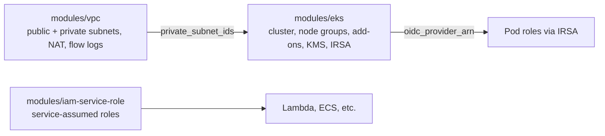

# terraform-aws-modules

Small, reusable Terraform modules for an AWS platform foundation: a VPC, an EKS cluster with IRSA, and a service-role helper. Each module has typed variables, safe defaults, and outputs designed to plug into the next one.

## Architecture



## Modules

| Module | What it does |
|--------|--------------|
| `modules/vpc` | VPC with public/private subnets per AZ, optional NAT (single or per-AZ), locked-down default security group, optional flow logs, EKS discovery tags |
| `modules/eks` | EKS cluster with KMS secrets encryption, control plane logging, managed node groups, core add-ons, and an IRSA OIDC provider |
| `modules/iam-service-role` | Role assumable by AWS services, with managed or inline policies and an optional permissions boundary |

## Usage

```hcl
module "vpc" {
  source               = "./modules/vpc"
  name                 = "demo"
  cidr_block           = "10.0.0.0/16"
  azs                  = ["ca-central-1a", "ca-central-1b"]
  public_subnet_cidrs  = ["10.0.0.0/24", "10.0.1.0/24"]
  private_subnet_cidrs = ["10.0.10.0/24", "10.0.11.0/24"]
  eks_cluster_name     = "demo"
}

module "eks" {
  source       = "./modules/eks"
  cluster_name = "demo"
  subnet_ids   = module.vpc.private_subnet_ids
}
```

A full working stack is in `examples/complete`. Set `admin_cidrs = ["<your-ip>/32"]` to reach the API server from your machine; leave it empty for a private-only endpoint.

## Design decisions

- **Private by default**: nodes live in private subnets and the EKS API endpoint is private unless you allow specific CIDRs. Wide-open public access is rejected by a precondition.
- **Secrets encryption**: a dedicated KMS key with rotation encrypts Kubernetes secrets.
- **Cost vs. resilience is a switch**: `single_nat_gateway = true` for dev, `false` for one NAT per AZ.
- **Locked default security group**: removes the permissive default rules, a common CIS finding.
- **Autoscaler-friendly**: `desired_size` is ignored after creation so a cluster autoscaler or Karpenter can manage it.
- **Access entries enabled**: authentication mode is `API_AND_CONFIG_MAP`, so cluster access can move to access entries without recreating the cluster.

## Testing

- `terraform validate` runs on every module and the example in CI.
- `modules/vpc/tests` has native `terraform test` cases with a mocked AWS provider (NAT modes, subnet counts), so they run without credentials.
- TFLint and a Trivy config scan run on every pull request.

## Cost warning

`examples/complete` creates an EKS cluster, NAT gateway and EC2 nodes, which cost money while running. Run `terraform destroy` when you are done.

## Roadmap

- Karpenter module and AWS Load Balancer Controller via IRSA
- A reusable IRSA role submodule
- EKS Pod Identity option
- Terratest or `terraform test` coverage for the EKS module

## License

MIT
